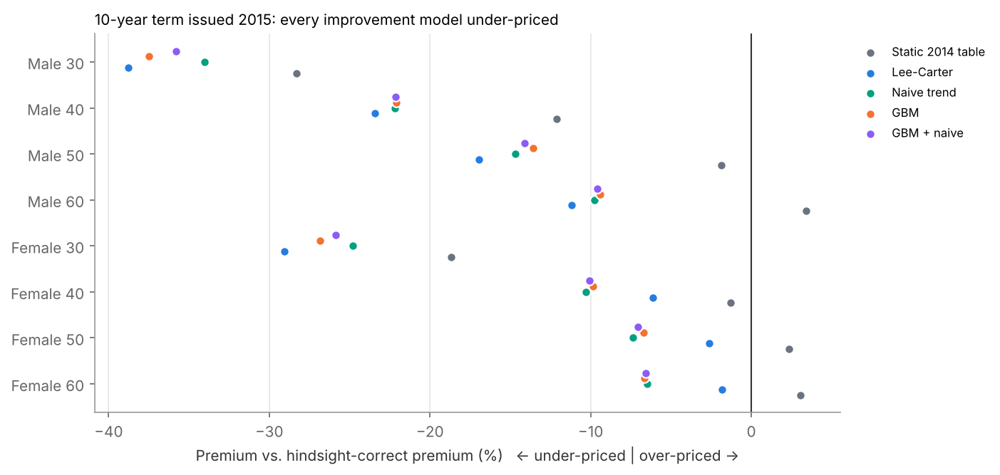
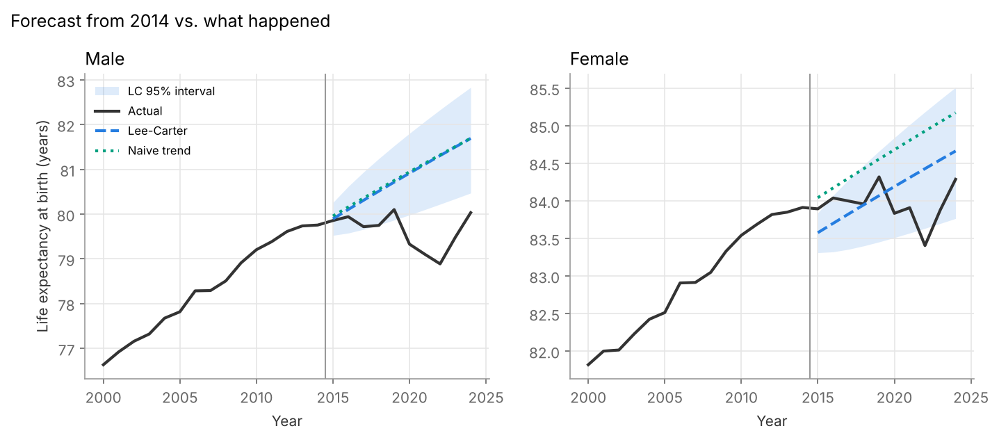
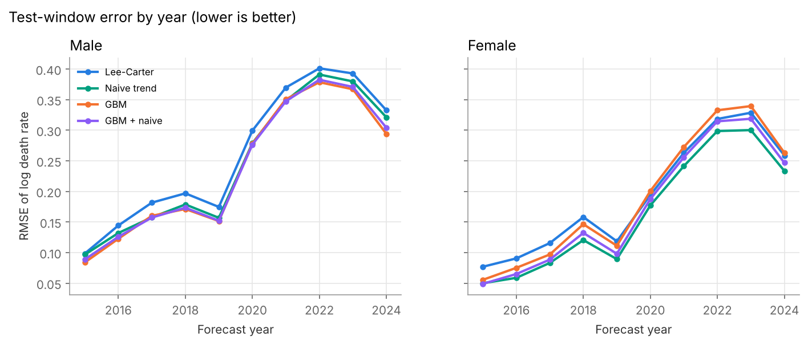

# Forecasting Canadian Mortality: Lee-Carter vs. Machine Learning

> I'm building this project during my Master of AI. The analysis is complete through insurance pricing; a final write-up is next (see the [roadmap](#roadmap)).

## Why this matters

Life insurance pricing, reserving and retirement planning all rest on one question: **how fast will mortality keep improving?** Actuaries have long used the **Lee-Carter** model for this. This project tests that model honestly on Canadian data, then asks whether machine-learning models can forecast age- and sex-specific death rates more accurately, and what they give up in interpretability and stability.

I work as a life insurance advisor (CLU®), so I care most about the ages and errors that affect term life pricing.

## Key findings

> **Headline:** For a 10-year term policy issued in 2015, every model that assumed mortality would keep improving **under-priced at every issue age** we tested: by about 22% for a 40-year-old man and 34–39% for a 30-year-old man. A plain "no improvement" table came closest in 7 of 8 cases. Choosing *whether* to assume improvement mattered far more than choosing *which* model. ([notebook 04](notebooks/04_insurance_pricing.ipynb))




**1. Canadian mortality stopped improving for young adults about a decade before COVID.** Over 2009–2019, death rates at ages 20–39 *rose* by about 1.4% a year for men and 0.9% a year for women, while ages 60+ kept improving. ([notebook 01](notebooks/01_eda.ipynb))


**2. Lee-Carter fit the past well but was overconfident about the future.** Trained on 1980–2014, one component explains 96% (male) of the variation in log death rates. But its 2015–2024 forecast:
* was beaten by a naive per-age trend for both sexes;
* forecast male death rates at ages 20–44 about **21% too low** in 2015–2019, before the pandemic (too optimistic, which for a life insurer means term premiums that are too low);
* put male life expectancy **below its own 95% interval every year from 2020 to 2024** (2024: forecast 81.7, actual 80.0). ([notebook 02](notebooks/02_lee_carter.ipynb))



| Backtest 2015–2024 (ages 0–100) | log RMSE 2015–19 | log RMSE 2020–24 | MAPE (all years) |
|---|---|---|---|
| Male: Lee-Carter | 0.163 | 0.361 | 17.4% |
| Male: naive per-age trend | **0.147** | **0.346** | **16.4%** |
| Female: Lee-Carter | 0.115 | 0.277 | 11.7% |
| Female: naive per-age trend | **0.084** | **0.254** | **11.3%** |

**3. Gradient boosting helped for men, not for women, and no model saw the trend break coming.** A tree model on (age, year, sex) can't forecast at all: it goes flat after the last training year. Reframed to predict *how much* log mortality changes over the next 1–10 years, from age, sex, horizon and past improvement, gradient boosting became a reasonable forecaster. Settings were chosen on a separate 2005–2014 validation window before the test years were touched. ([notebook 03](notebooks/03_ml_models.ipynb))

| Test 2015–2024, log RMSE (all ages) | Lee-Carter | Naive trend | GBM | GBM + naive |
|---|---|---|---|---|
| Male | 0.280 | 0.266 | **0.258** | 0.260 |
| Female | 0.212 | **0.189** | 0.215 | 0.201 |

* All four models forecast death rates at ages 20–44 **9–21% too low** before the pandemic, and all missed male life expectancy in 2024 by about 1.7 years. Model choice mattered far less than the trend break.
* At ages 85+, Lee-Carter was 6–7% too pessimistic, while the per-age models were within about 1.5%. That matters for annuity pricing.
* Permutation importance shows the GBM leans on the *long-run* improvement rate and almost ignores the last five years. That explains why it was slow to react.



**4. In dollars, mortality assumptions dominate interest assumptions.** On 10,000 policies of $500,000 sold to 40-year-old men in 2015, each improvement model leaves about **$20 million** of present-value shortfall. Moving the interest rate by one point changes the premium by under 2%; the choice of mortality assumption moves it by 9–11 points. Refitted on data through 2024, reasonable assumptions still disagree by **9–44%** on today's premium. ([notebook 04](notebooks/04_insurance_pricing.ipynb))

**5. The life-table code is checked against official numbers.** Life expectancy rebuilt from `qx` matches StatCan's published values to within 0.01 years for every year 1980–2024. This is enforced by a unit test.

*Pricing results use population mortality and net premiums only (no expenses, lapses or underwriting), so the percentages are the point, not the dollar levels.*

### Why this is a model-risk story
OSFI's Guideline E-23 (Model Risk Management), which takes effect in May 2027, expects federally regulated institutions, including life insurers, to validate models (AI/ML included) against outcomes and to understand their limitations. Points 2–4 are a small example: a standard model that looks excellent in-sample can be systematically wrong out of sample at exactly the ages that drive term-life pricing, and a more complex ML model is not automatically better. Benchmarks and validation are what reveal both, and pricing the results in dollars shows why it matters.

## Data

**Statistics Canada, Table 13-10-0837-01**: complete life tables for Canada, by sex and single year of age 0–110+, **1980–2024** ([details](data/README.md)).
The processed file `data/processed/canada_qx_1980_2024.csv` is included, so the notebooks run without downloading anything.

## Roadmap

- [x] **Data pipeline:** StatCan Web Data Service → tidy `qx` table; reshape into age × year matrices by sex
- [x] **Validation:** rebuild life expectancy and match StatCan's published values (unit-tested)
- [x] **EDA:** mortality by age, improvement rates by age band and decade, COVID-19 excess vs. the pre-pandemic trend
- [x] **Baseline:** Lee-Carter from scratch (SVD fit, random walk with drift for κₜ, prediction intervals)
- [x] **Backtest:** train 1980–2014, forecast 2015–2024; error by year and by age band; naive benchmark
- [x] **ML models:** gradient boosting on mortality change (age, sex, horizon, past improvement), tuned on a 2005–2014 validation window, scored on the same backtest; permutation importance
- [x] **Insurance view:** net premiums for 10-year term (issue 2015, ages 30–60) under each assumption vs. the hindsight-correct premium; shortfall per 10,000 policies; pre-COVID check; interest-rate comparison; pricing a 2025 issue
- [ ] **Write-up:** results, limitations (short series, pandemic years), next steps

## Project structure

```
data/processed/   StatCan life-table data (qx) + official life expectancy for checks
notebooks/        01_eda · 02_lee_carter · 03_ml_models · 04_insurance_pricing   (src_py/ holds the same notebooks as plain .py scripts)
reports/figures/  charts used in this README
src/
  data.py         load / reshape / download (StatCan WDS)
  lifetable.py    life expectancy, term-insurance and annuity present values
  lee_carter.py   Lee-Carter model + naive benchmark
  ml.py           gradient boosting on mortality change, leak-free features
  pricing.py      term-life net premiums along each policyholder's age/year path
  evaluate.py     log RMSE, MAPE, error by year
tests/            unit tests (pytest)
```

## How to run

```bash
git clone https://github.com/maqimu-byte/canada-mortality-forecasting.git
cd canada-mortality-forecasting
python -m venv .venv && source .venv/bin/activate   # Windows: .venv\Scripts\activate
pip install -r requirements.txt
pytest                      # 11 checks: StatCan e0 match, Lee-Carter recovery, no look-ahead in ML features, premium formula
jupyter notebook notebooks/
```

## Tech

Python · pandas · NumPy · scikit-learn · matplotlib · pytest

---
*Qianmeng (Laura) Ma, Master of AI student (Seneca Polytechnic), CLU®.*
