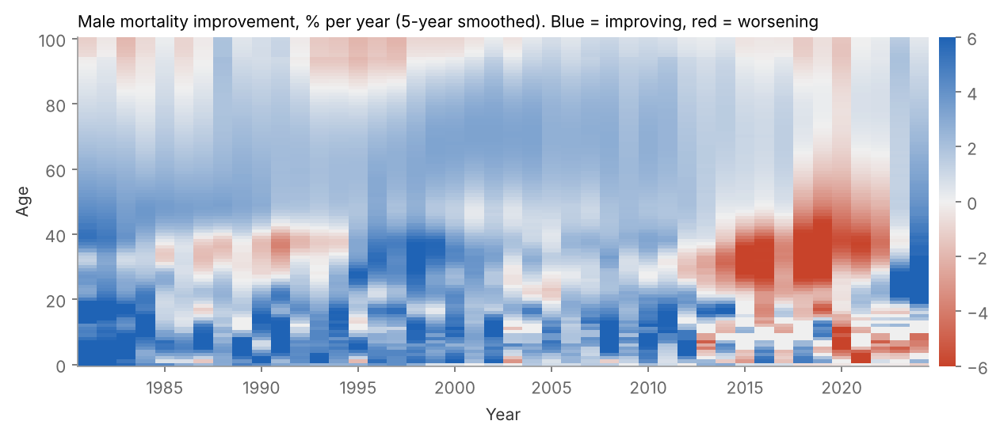

# Forecasting Canadian Mortality: Lee-Carter vs. Machine Learning

> 🚧 **In progress.** I'm building this project during my Master of AI (target: spring 2027). The data pipeline, exploratory analysis and Lee-Carter baseline are done. ML models and insurance pricing are next (see the [roadmap](#roadmap)).

## Why this matters

Life insurance pricing, reserving and retirement planning all rest on one question: **how fast will mortality keep improving?** Actuaries have long used the **Lee-Carter** model for this. This project tests that model honestly on Canadian data, then asks whether machine-learning models can forecast age- and sex-specific death rates more accurately, and what they give up in interpretability and stability.

I work as a life insurance advisor (CLU®), so I care most about the ages and errors that affect term life pricing.

## Key findings so far

**1. Canadian mortality stopped improving for young adults about a decade before COVID.** Over 2009–2019, death rates at ages 20–39 *rose* by about 1.4% a year for men and 0.9% a year for women, while ages 60+ kept improving. ([notebook 01](notebooks/01_eda.ipynb))



**2. Lee-Carter fit the past well but was overconfident about the future.** Trained on 1980–2014, one component explains 96% (male) of the variation in log death rates. But its 2015–2024 forecast:
* was beaten by a naive per-age trend for both sexes;
* forecast male death rates at ages 20–44 about **21% too low** in 2015–2019, before the pandemic (too optimistic, which for a life insurer means term premiums that are too low);
* put male life expectancy **below its own 95% interval every year from 2020 to 2024** (2024: forecast 81.7, actual 80.0). ([notebook 02](notebooks/02_lee_carter.ipynb))


| Backtest 2015–2024 (ages 0–100) | log RMSE 2015–19 | log RMSE 2020–24 | MAPE (all years) |
|---|---|---|---|
| Male: Lee-Carter | 0.163 | 0.361 | 17.4% |
| Male: naive per-age trend | **0.147** | **0.346** | **16.4%** |
| Female: Lee-Carter | 0.115 | 0.277 | 11.7% |
| Female: naive per-age trend | **0.084** | **0.254** | **11.3%** |

**3. The life-table code is checked against official numbers.** Life expectancy rebuilt from `qx` matches StatCan's published values to within 0.01 years for every year 1980–2024. This is enforced by a unit test.

### Why this is a model-risk story
OSFI's Guideline E-23 (Model Risk Management), which takes effect in May 2027, expects federally regulated institutions, including life insurers, to validate models (AI/ML included) against outcomes and to understand their limitations. Point 2 is a small example: a standard model that looks excellent in-sample can be systematically wrong out of sample, at exactly the ages that drive term-life pricing.

## Data

**Statistics Canada, Table 13-10-0837-01**: complete life tables for Canada, by sex and single year of age 0–110+, **1980–2024** ([details](data/README.md)).
The processed file `data/processed/canada_qx_1980_2024.csv` is included, so the notebooks run without downloading anything.

## Roadmap

- [x] **Data pipeline:** StatCan Web Data Service → tidy `qx` table; reshape into age × year matrices by sex
- [x] **Validation:** rebuild life expectancy and match StatCan's published values (unit-tested)
- [x] **EDA:** mortality by age, improvement rates by age band and decade, COVID-19 excess vs. the pre-pandemic trend
- [x] **Baseline:** Lee-Carter from scratch (SVD fit, random walk with drift for κₜ, prediction intervals)
- [x] **Backtest:** train 1980–2014, forecast 2015–2024; error by year and by age band; naive benchmark
- [ ] **ML models:** gradient boosting on (age, year, sex) features and on Lee-Carter residuals, using the same backtest
- [ ] **Insurance view:** expected present value of a 20-year term life benefit under each model's forecast, and how much model choice moves the price
- [ ] **Write-up:** results, limitations (short series, pandemic years), next steps

## Project structure

```
data/processed/   StatCan life-table data (qx) + official life expectancy for checks
notebooks/        01_eda · 02_lee_carter   (src_py/ holds the same notebooks as plain .py scripts)
reports/figures/  charts used in this README
src/
  data.py         load / reshape / download (StatCan WDS)
  lifetable.py    life expectancy, term-insurance and annuity present values
  lee_carter.py   Lee-Carter model + naive benchmark
  evaluate.py     log RMSE, MAPE, error by year
tests/            unit tests (pytest)
```

## How to run

```bash
git clone https://github.com/maqimu-byte/canada-mortality-forecasting.git
cd canada-mortality-forecasting
python -m venv .venv && source .venv/bin/activate   # Windows: .venv\Scripts\activate
pip install -r requirements.txt
pytest                      # runs the checks, including the match to StatCan's life expectancy
jupyter notebook notebooks/
```

## Tech

Python · pandas · NumPy · scikit-learn · matplotlib · pytest

---
*Qianmeng (Laura) Ma, Master of AI student (Seneca Polytechnic), CLU®.*
